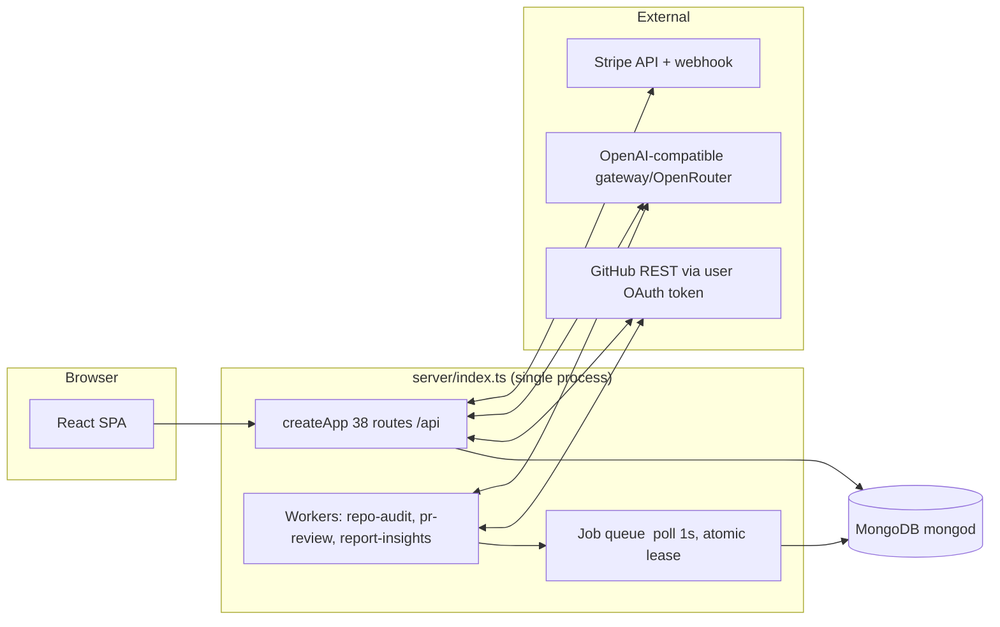

# Current State — Architecture Audit (Milestone 0)

> Audited: `development` @ `9e8e284`, file-tree + full-source inspection on 2026-11-04.
> All claims below carry file:line evidence from the audit. Three prior knowledge packages were
> verified against source; anything unverified is explicitly labeled.
> Companion: [`issue-register.md`](../implementation/issue-register.md) (full register) · [`target-architecture.md`](target-architecture.md)

## 1. Stack snapshot (verified)

| Layer | Technology | Notes |
|---|---|---|
| Frontend | React 19, Vite 7, TypeScript 5.6, Tailwind v4, wouter 3, TanStack Query 5, framer-motion 12, shadcn/Radix | Single SPA served by the API in dev; nginx in split prod |
| Backend | Express 5, Node 20, Mongoose 9 / MongoDB, Zod 3 | Modular monolith, 38 route handlers, all under `/api` |
| Auth | GitHub OAuth App + stateless JWT in httpOnly cookie (7d) | Tokens AES-256-GCM encrypted at rest |
| AI | OpenAI-compatible gateway → OpenRouter; Zod output gate + corrective retry | Task registry: `repo-audit`, `pr-review`, `report-insights` — all currently on the `triage` model tier |
| Billing | Stripe 20 checkout + signed webhooks | Plans: starter 5/2, pro 100/100, agency unlimited |
| Jobs | Mongo-backed queue (`findOneAndUpdate` lease claim, 15-min lease, backoff retries) | In-process workers; API-only / worker-only deploy flags exist |
| Infra | Docker (monolith + split client/nginx + server images), compose, GH Actions CI (lint/check/test/build) | No CD, no docker image build in CI |
| Tests | vitest + supertest + mongodb-memory-server; 9 files / 70 tests | Server-only; no client tests, no e2e; test files excluded from `tsc` |

## 2. Runtime topology (verified)

- **Bootstrap** (`server/index.ts`): connectDB → conditional workers (`DISABLE_WORKERS` / `WORKER_ONLY`) →
  static/dev-vite → terminal handlers → listen.
- **Router mounts** (`server/app.ts:66-73`): `auth, repos, audits, reviews, reports, billing, jobs, pr-manager`
  — all at base `/api`. Health: `GET /api/health` (no auth, no DB round-trip).

## 3. API surface (verified, 38 handlers)

| Module | Routes (method path — access model) |
|---|---|
| auth | `GET /auth/github` (pub) · `GET /auth/github/callback` (pub, state-verified) · `GET /auth/logout` (pub, state-changing GET) · `GET /auth/user` (silent-verify) |
| repos | `GET /repos` (GitHub proxy, ≤100, unpaged) · `GET /repos/:o/:r/branches` (proxy) |
| audits | `POST /repos/:o/:r/audit` (usage gate → enqueue job) · `GET /audits` (own) · `GET /audits/:id` (404-foreign) · `GET /audits/:id/fix-preview` (own audit; **owner/repo from query unverified**) · `POST /repos/:o/:r/fix-contents` (**no DB ownership; arbitrary file map**) · `POST /audits` (mass-assign body) · `PATCH /audits/:id` (own; mass-assign minus userId) · `DELETE /audits/:id` (own + cascade, untransacted) · `POST /audits/:id/items` (own parent) · `PATCH|DELETE /audit-items/:id` (item-owner w/ legacy fallback) · `POST /repos/:o/:r/fix` (arbitrary issues from body) |
| reviews | `GET /pulls` (**search/issues author-restricted**) · `GET .../pulls/:n/files` · `POST .../pulls/:n/audit` (usage gate; **UI calls GET — dead path, see A-01**) · `POST .../pulls/:n/fix` (commits onto head branch; per-file errors swallowed) · `PUT .../pulls/:n/merge` (squash; deletes temp branches) · `GET .../pulls/:n` (detail) · `PATCH .../pulls/:n` (base/title/body/state) |
| reports | `POST /audits/:id/generate-insights` (job) — **no read route for Report rows at all** |
| billing | `POST /billing/create-checkout-session` · `POST /billing/verify-session` (metadata.userId ownership) · `POST /billing/webhook` (signed, 3 event types, no event-id ledger) |
| jobs | `GET /jobs/:id` (own-404, sanitized) · `GET /jobs/:id/events` (SSE, 1.5s DB polls) |
| pr-manager | drafts CRUD + history list/create (all userId-filtered) |

## 4. Data models (verified shape)

| Model | Ownership / linkage | Indexes | Key gaps for 2.0 |
|---|---|---|---|
| User | `githubId` unique; plan; stripe ids; AES token (`select:false`); frozen legacy counters | unique githubId | User-centric; no workspace |
| **Audit** | `userId?` nullable + `auditorId?` legacy string; **no owner/repo anywhere** | `{userId,createdAt:-1}` | Repo exists only as text in title/scope → cannot address by repository |
| AuditItem | userId + auditId; `value`=file path | `{userId,auditId}`, `{auditId,severity}` | No fingerprint → no dedupe/lifecycle |
| AuditHistory | userId, prId string, per-file changes | `{userId,createdAt:-1}`, `{prId}` | Manual log, no linkage to commits/PRs entity |
| AuditLog | TTL 180d, action-indexed | `{createdAt}` TTL, `{userId,createdAt:-1}` | good |
| DraftPR | userId; **has owner/repo/targetBranch** (only model) | `{userId,updatedAt:-1}` | Not workspace-scoped |
| Report | userId+auditId; riskScore; generatedContent | `{userId,createdAt:-1}`, `{auditId}` | Unreadable (no route) |
| AIUsage | task/model/promptVersion/tokens | task, userId, jobId, time | Costs tracked per model response incl. rejected attempts |
| UsageRecord | userId+action+period unique | **unique `{userId,action,period}`** (atomic gate) | Per-user only — needs workspace meter |
| Job | type enum {repo-audit, pr-review, report-insights}; state/lease/attempts | `{state,runAt}`, `{userId,createdAt:-1}` | pr-review type is currently dead (nothing enqueues it) |

## 5. What genuinely works well (keep, don't break)

1. **Auth token hygiene**: AES-GCM envelopes, lazy legacy plaintext migration w/ `$unset`, redacting pino
   logger (`config/logger.ts:12-33`), single-use HMAC'd OAuth state. Verified no token leakage into logs.
2. **Evidence anchoring of AI output** (`audits/service.ts:159-298`): path resolution + token-scan anchor
   recovery — findings never trust AI-supplied locations blindly. This is the product's credibility core.
3. **Atomic usage ledger** with unique-key race handling and clamp-refunds (`usage/service.ts:44-117`) +
   402 envelope the UI can already surface.
4. **Job queue discipline**: atomic claim `findOneAndUpdate` w/ lease reclaim + backoff + permanent-fail +
   refund; adapter shape exists for BullMQ swap.
5. **AI gateway**: Zod gate with one corrective retry, transient-only retries, fail-fast on quota, AIUsage
   row per response incl. rejected attempts, untrusted-data fencing for repo content.
6. **Fix editor UX** (`AuditEditPage`) and PR composer with server-parity branch slug.
7. **Ownership tests exist** for the user-owned resources (404-not-403 design) — a pattern to generalize.

## 6. Verified gaps (proof-carrying summary; full register in issue-register.md)

**Architecture/data (blocks the 2.0 mission):**
- Audit/user-centric data — no Repository/PullRequest/Finding entities; repo identity reconstructed from
  text (`models/Audit.ts:18-33`).
- PR visibility: author-restricted search, 30-cap, unpaged (`reviews/routes.ts:42-44`); repos endpoint caps
  at 100 (`repos/routes.ts:22`).
- No provider abstraction: direct GitHub paths inside every service; GitHub App config dead
  (`env.ts:57-62` unused); no webhook route at all (rawBody captured for it, `app.ts:50`).

**Correctness/security of shipped flows:**
- Frontend "Review with AI" calls GET on a POST-only route → silently dead in current HEAD (`api-service.ts:138-142`
  vs `reviews/routes.ts:90`); fixed on this branch.
- SPA fallbacks (dev vite + prod static) return 200 HTML for *any* unmatched `/api` path — masks bad API
  calls, breaks error surfaces (`server/vite.ts:34-57`, `server/static.ts:25-27`).
- Helmet + express-rate-limit installed but never used (no headers, no throttling) — `app.ts` imports none.
- Zero zod validation on route bodies; mass-assignment on audits create/patch (`audits/routes.ts:181-194`).
- Raw error messages leak from module-level catch blocks (`audits/routes.ts:46`, `reviews/routes.ts:122,178`,
  `billing/routes.ts:36-39`) bypassing the sanitizing central handler.
- Queue `complete()`/`fail()` lack state guards; `fail()` is read-then-write (`jobs/queue.ts:103-147`) —
  zombie finals possible under lease expiry races.
- Audit writes and delete cascades untransacted (`audits/service.ts:418-447,74-78`).
- No SIGTERM/SIGINT shutdown; initial Mongo connect fail-fast; Docker images run as root; `express.static`
  without cache headers.

**AI quality of review (the product is "AI audit"):**
- `reviewPullRequest` fetches PR files with **no `per_page`** → first 30 files only, silently
  (`reviews/service.ts:36`); `patch` may be `undefined` → literal "undefined" prompt context.
- All tasks pinned to the triage model; deep tier defined but never used.
- Report insights exists (job → Report row) but nothing can read Report rows (no route, no UI).

**Trust/commercial mismatch:**
- Marketing claims unimplemented features (weekly automated audits, real-time PR audits, white-label,
  rules engine) while implemented value (limit 402 envelope, reports, insights) is unreachable or silently
  swallowed in the UI (dead `LimitReachedModal`, dead routes `/app/pulls/:n/edit`, `/app/audit/.../fix/:id`,
  unreachable `/app/pr-manager`, decorative SettingsPage).
- License field says MIT; no LICENSE file; package still named `rest-express`.

## 7. Test coverage map (verified, 70 tests)

| Test file | Covers |
|---|---|
| `lib/crypto.test.ts` | AES-GCM round-trip, tamper, malformed envelope, safeEqual |
| `config/env.test.ts` | defaults, prod-required secrets, worker flags, GitHub auth modes |
| `integrations/ai/gateway.test.ts` | routing, corrective retry, 503 exhaustion, 429 backoff, quota fail-fast, usage rows, untrusted fencing |
| `modules/jobs/queue.test.ts` | atomic claim, lease reclaim, FIFO, backoff, permanent fail |
| `modules/usage/usage.test.ts` | UTC periods, concurrency race, refund clamp, unlimited, 402 shape |
| `modules/audits/resolve.test.ts` | path resolution heuristics |
| `modules/audits/ownership.test.ts` | model+HTTP ownership (404-foreign, spoofed userId ignored) |
| `modules/audits/fixes.test.ts` | locateCode, batched per-file commits, partial success, 400-on-nothing |
| `modules/audits/anchor.test.ts` | anchor token weighting, recovery threshold, no fabrication |

Not covered: workspaces (new), provider adapters, webhooks, billing webhook replay, findings/fingerprints,
client code, e2e journeys. Tests are excluded from `tsc` (`tsconfig.json:3`) — must be re-included in M1.
