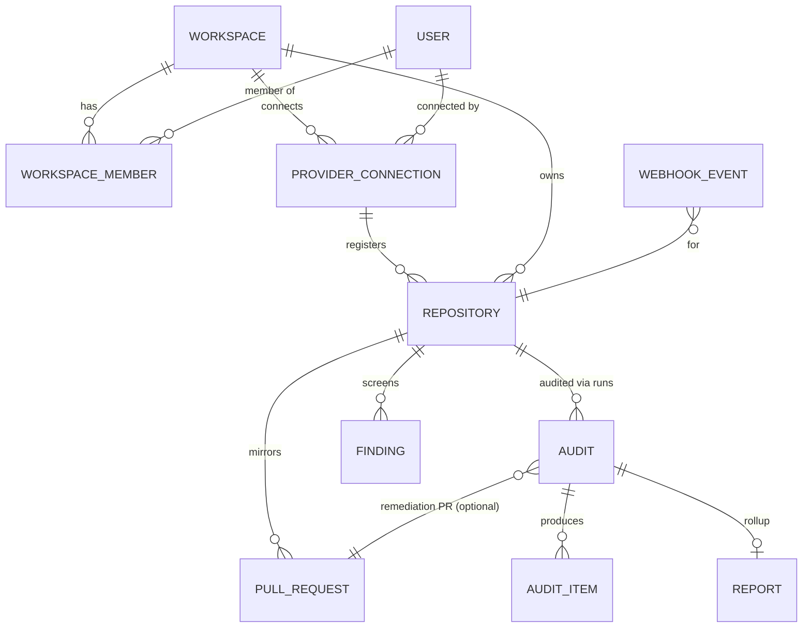

# Database Design — AuditPilot 2.0

> Status: Phase 0/F-01 artifact. Collection specs below are the M1 implementation contract (models names,
> indexes and uniqueness are implemented on this branch; consumer rewiring lands M2–M4).
> Companion: [`current-state.md`](current-state.md) §4 (existing models kept as-is) · [`provider-abstraction.md`](provider-abstraction.md)

## 1. Domain distinction (binding)

- **Audit** — one historical scan execution for a (repository, branch, commitSha) at a time.
- **AuditItem** — evidence + proposal produced by *that* execution (unchanged semantics, now also
  workspace/repository stamped).
- **Finding** — the long-lived issue itself, identified by a stable fingerprint, persisting across audit
  runs, with lifecycle status, first/last seen, resolution and links.

## 2. Entity relationship (target)

All workspace-scoped collections carry `workspaceId`; all provider-mirrored collections carry
`providerConnectionId` + `providerExternalId` so data survives account reconnection.

## 3. New collections (M1 contract — implemented on this branch)

### Workspace
| field | type / rule |
|---|---|
| name | string, required, trimmed |
| slug | string, required, unique, lowercase `[a-z0-9-]{1,63}` |
| owner | ObjectId → User, required |
| type | enum `personal | team | agency`, default `personal` |
| plan | enum `starter | pro | agency`, default `starter` |
| stripeCustomerId / stripeSubscriptionId | string, optional (billing moves here in M9) |
Indexes: **unique** `{slug}`; `{owner}`; `{createdAt}`.

### WorkspaceMember
| field | rule |
|---|---|
| workspaceId | ObjectId → Workspace, required |
| userId | ObjectId → User, required |
| role | enum `owner | admin | developer | viewer`, default `developer` |
| status | enum `active | invited | suspended`, default `active` (invitations populated M8) |
| invitedBy / invitedAt, joinedAt | optional scaffolding for M8 |
Indexes: **unique `{workspaceId, userId}`** (one role per membership); `{userId}` (reverse lookup).

### ProviderConnection
| field | rule |
|---|---|
| workspaceId | ObjectId, required, indexed |
| provider | enum `github | bitbucket` (github shipping now; bitbucket M5) |
| kind | enum `oauth-user | github-app`, default `oauth-user` |
| connectedByUserId | ObjectId (audit trail who connected) |
| providerAccountId | string — GitHub numeric user id (immutable identity survives renames) |
| providerAccountLogin | string, display |
| providerAccountType | `User | Organization`, optional |
| scopes | string array |
| credentialsEncrypted | **string, required, AES-GCM envelope (same lib/crypto scheme as User) `select:false`** |
| credentialExpiresAt / refreshEncrypted / refreshExpiresAt | optional (Bitbucket refresh needs this in M5) |
| status | enum `connected | revoked | error`, default `connected` |
Indexes: `{workspaceId}`, `{connectedByUserId}`.
Rationale: connection is the integration credential *per workspace*; OAuth-user tokens remain usable by a
personal workspace; GitHub App installation connections (kind=github-app) arrive M3 with installationId.

### Repository
| field | rule |
|---|---|
| workspaceId + providerConnectionId | required (both enforced at app level) |
| provider | enum, persisted for provider-agnostic queries |
| providerExternalId | string — GitHub repository node id / Bitbucket uuid. **Stable even if the repo is renamed.** |
| ownerLabels | `{ account, fullName }` denormalized display strings |
| name, description, visibility (`private|public|internal`), archived boolean | mirrored |
| defaultBranch | string, optional, synced |
| syncState | enum `pending | active | error | removed`, default `pending` |
| lastSyncedAt | Date, optional |
| connectionRemovedAt / removedAt | soft-remove timestamps (M3 reconciliation) |
Indexes: **unique `{workspaceId, provider, providerExternalId}`** — prevents duplicate registration of the
same external repo inside one workspace/connection scope; `{providerConnectionId}`; `{workspaceId, syncState}`.

### PullRequest
| field | rule |
|---|---|
| workspaceId + repositoryId | required |
| provider | enum |
| providerExternalId | string (node id), optional-but-stable when provider returns it |
| number | number (provider PR number) |
| title, body | strings (description preserved) |
| author | `{ login, avatarUrl }` |
| sourceBranch, destinationBranch | strings (normalized refs) |
| state | enum `open | closed | merged` |
| isDraft | boolean |
| url | string |
| additions / deletions | numbers |
| headSha | string (review dedupe + stale-SHA detection) |
| checkStatus | enum `none | pending | passing | failing`, default none |
| firstSeenAt, lastSeenAt | sync bookkeeping |
Indexes: **unique `{repositoryId, provider, number}`**; `{workspaceId, state, lastSeenAt}` (inbox queries);
`{headSha}` (dedupe AI reviews per head).

### Finding (model ships M1; lifecycle features activate in M4)
| field | rule |
|---|---|
| workspaceId + repositoryId + auditId | first/last seen linkage |
| fingerprint | string, required — deterministic hash of `(ruleSlug?, normalized file path + symbol anchor + issue class)`; **stable across audit runs and (best-effort) minor file churn**; versioned prefix `v1:` |
| ruleId | string (scanner rule or `ai:<promptVersion>`) |
| severity | enum `critical | high | medium | low` |
| category | enum `security | performance | quality | dependency | configuration | accessibility | architecture` |
| confidence | number 0–1 |
| filePath, lineStart, lineEnd | location (never fabricated) |
| evidence | `{ excerpt, oldCode?, context? }` |
| description, recommendation | strings |
| lifecycle status | enum `open | in_progress | fixed | verified | accepted_risk | ignored | reopened`, default `open` |
| firstDetectedAt, lastDetectedAt, resolvedAt | timestamps |
| relatedPullRequests / relatedCommits | ObjectId arrays, indexed |
Indexes: **unique `{repositoryId, fingerprint}`** (dedupe spine), `{workspaceId, repositoryId, lifecycle status}`,
`{repositoryId, severity}`, `{firstDetectedAt}`.

## 4. Existing collections — additive enhancements (M1)

| Collection | Change | Migration behavior |
|---|---|---|
| Audit | + `workspaceId?`, `repositoryId?`, `provider?`, `commitSha?`, `auditType?` (default `repo_full`), `originatingJobId?` | Fields nullable; fork filter indexes `{workspaceId, createdAt:-1}`. **No backfill of history** — legacy audits lack enough data to unambiguously associate a full_name repo; they remain user-scoped until M4's audit-comparison feature, and the migration reports them as `legacy-unlinked`. |
| User | untouched (personal workspace provisioning derives from it) | — |

Rollback safety: all M1 changes are additive (new collections; additive optional fields); a reversal
script drops the new collections and the added Audit fields (`scripts:workspace:rollback`).

## 5. Index strategy notes

- Uniqueness does the "cannot happen twice" enforcement server-side: membership, repository-registration,
  PR mirror, finding dedupe.
- Compound sorts mirror the dashboard queries we know we need: inbox (`workspaceId`,`state`,`lastSeenAt`),
  repo findings (`repositoryId`,`status`,`severity`), usage (`workspaceId`,`action`,`period` unique — added M9
  when metering moves).
- TTL: `AuditLog` 180d kept; new `WebhookEvent` ledger gets 30-day TTL (M3) — enough for replay forensics.
- Where Mongoose schema-level `unique:true` creates indexes on first use, an index check script
  (`npm run migrate:workspaces`) verifies/ prints missing indexes for ops.
