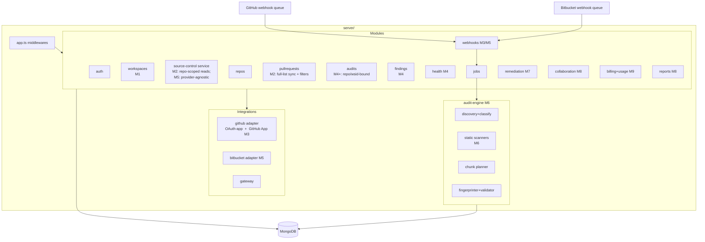
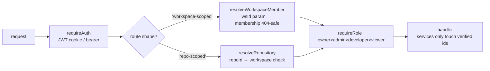
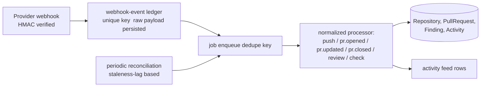

# Target Architecture — AuditPilot 2.0

> Status: Phase 0 artifact (M0). This is the agreed destination the milestone roadmap executes towards.
> Companion: [`current-state.md`](current-state.md) · [`database-design.md`](database-design.md) · [`provider-abstraction.md`](provider-abstraction.md) · [`roadmap.md`](../implementation/roadmap.md)

## 1. Architectural principles

1. **Workspace is the tenant.** Every persisted product resource is addressable through a workspace id,
   and access is granted only via workspace membership + role. No route accepts a workspace-scoped id
   without a membership check executed server-side (never trusting client-transmitted ownership).
2. **Repository is the unit of daily work.** PRs, findings, audits, activity and reports hang off stable
   repository ids — never off free-text `owner/repo` strings typed into URLs or titles.
3. **Providers are adapters.** Business logic consumes our normalized models. Provider SDK types stop at
   the adapter boundary. Capability differences become runtime capability checks, not scattered ifs.
4. **Snapshots vs. entities.** Audit = one scan execution (historical). Finding = long-lived issue with
   fingerprint + lifecycle. AuditItem = the evidence a given execution observed. PRs and repositories mirror
   provider state via sync, never invented locally.
5. **Static-first, AI-explains.** Deterministic scanners + heuristics produce facts; the AI explains,
   prioritizes and proposes fixes over verified facts. AI output is always Zod-validated and always
   anchored to fetched evidence.
6. **Additive migration only.** New pipeline: backfill (idempotent, reversible-safe) before swap-in of
   consumers, feature-flag where feasible. No destructive rewrites of user data.
7. **Modular monolith** until scaling forces otherwise; the job queue already has an adapter seam.

## 2. Target module map



**Growth path** (unchanged from spec): the tool-scanner set (Semgrep/Gitleaks/OSV) lands behind the
`Engine` boundary as *workers + detectors*, so the modular monolith stays; only scanners move to
sandboxed runners if local execution becomes unsafe/slow.

## 3. Request scoping pipeline (replaces "trust the client's ids")



- Legacy user-owned resources (audits v1, drafts, jobs…): existing ownership middlewares remain during
  transition; every NEW or re-scoped route uses the pipeline above. Access failures are **404-shaped**
  where the resource exists in another workspace (avoid existence leaks) and 403 where the resource is
  visible but the role forbids the operation.
- Cross-workspace writes must go through services that stamp `workspaceId` server-side.

## 4. Synchronization & webhooks (M3/M5)



- Dedupe keys: `provider:event:deliveryId` (ledger) and `pr-review:{repoId}:{headSha}` (AI reviews — one per head).
- Failure semantics: ledger row records `processed|retrying|dead` + error; a retry endpoint exists for operators.
- AI work is only *enqueued* from webhooks (never inline), respects dedupe, consumes usage before model spend.

## 5. AI audit engine target (M6+, replaces "send ≤8 files to the model")

Stage pipeline (each stage deterministic, typed, logged into the audit record):

1. discovery (tree) → 2. language/framework detect → 3. file classification (source/config/generated/binary)
→ 4. dependency manifest analysis → 5. secret scan → 6. static analysis (tools evaluated in M6) →
7. security/perf/a11y/config analysis heuristics → 8. architecture metrics → 9. AI investigations over
planned chunks (tier-gated: triage for breadth, deep for risky files/findings) → 10. finding validation
against fetched evidence (anchor machinery reused) → 11. fingerprinting → 12. remediation proposals →
13. verification hooks → 14. report generation.

Recording additions: model per call, prompt version, token counts, wall time, retry count, confidence —
already 90% provided by `AIUsage`; store per-audit rollups.

## 6. Frontend information architecture (M2/M8 reorganizes today's user-centric app)

```
/app                                   → Overview (global workspace dashboard)
/app/workspaces/:wsId                  → workspace-switched overview
/app/workspaces/:wsId/repositories/:repoId/overview
                                     /pulls     (all authors; filters; sync-state aware)
                                     /audits    (+ comparison)
                                     /findings  (explorer: filters, status, assignee)
                                     /branches  /activity  /reports  /settings
/app/workspaces/:wsId/settings         (members, connections, policies, billing surface)
```

Global PR inbox lives under the same normalized service as repo PRs (no parallel sync code). Every list
surface states: loading / error+retry / empty / synced-at / permission-denied — the current UI conflates
error with empty; that changes with M2.

## 7. Delivery discipline

- Migrations run before consumers are re-pointed; each milestone ships its scripts + tests.
- Feature flags (env-based) around major behavior switches (`FINDINGS_ENABLED`, `PROVIDER_SCOPING`, …)
  so rollback = flag off, not revert.
- Every milestone closes with gates: `npm run lint`, `npm run check` (tests re-included), `npm run test`,
  `npm run build`; docs updated; remaining limitations recorded honestly in roadmap status.
